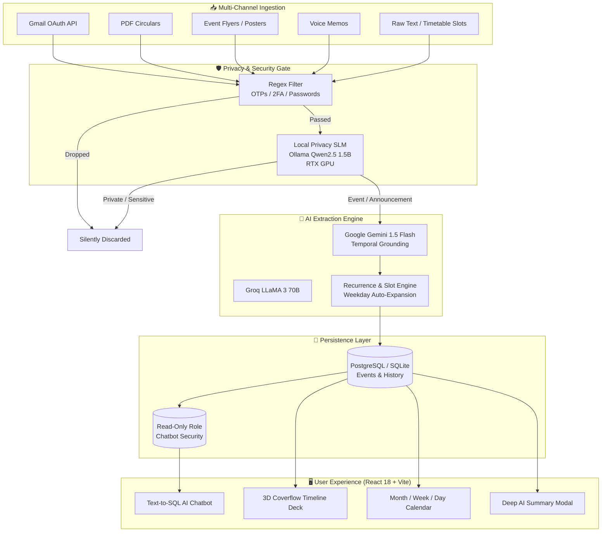

# 🎯 Smart Event Hub (`evenrhub`)

<div align="center">


[](https://fastapi.tiangolo.com/)
[](https://react.dev/)
[](https://tailwindcss.com/)
[](https://ollama.com/)
[](https://aistudio.google.com/)
[](https://www.postgresql.org/)
[](LICENSE)

*An AI-driven campus life and schedule orchestrator that transforms cluttered inboxes, PDFs, flyers, and voice memos into an interactive 3D Coverflow Timeline and unified calendar.*

</div>

---

## 🌟 Table of Contents
- [💡 Motivation](#-motivation)
- [✨ Key Features](#-key-features)
- [🏛️ System Architecture](#️-system-architecture)
- [🛡️ Multi-Tier Privacy Pipeline](#️-multi-tier-privacy-pipeline)
- [🛠️ Tech Stack](#️-tech-stack)
- [🚀 Quick Start & Installation](#-quick-start--installation)
  - [Prerequisites](#prerequisites)
  - [1. Environment Configuration](#1-environment-configuration)
  - [2. Local SLM (Ollama) Setup](#2-local-slm-ollama-setup)
  - [3. Backend Setup](#3-backend-setup)
  - [4. Frontend Setup](#4-frontend-setup)
  - [5. Public Tunnel (Cloudflare)](#5-public-tunnel-cloudflare)
- [📱 User Interface Overview](#-user-interface-overview)
- [🔌 API Reference](#-api-reference)
- [🔒 Security & Privacy Notice](#-security--privacy-notice)
- [🤝 Contributing](#-contributing)
- [📄 License](#-license)

---

## 💡 Motivation

### The Modern Student Problem
At technical universities like IIT Madras, students receive **50 to 100+ unorganized emails every single day**:
- Department circulars, timetable changes, and elective announcements.
- Placement drive schedules and recruitment shortlists from training cells.
- Hackathon invites, technical symposiums, and cultural festivals.
- Hostel mess circulars, administrative alerts, and club activities.

Because information is scattered across dense text bodies, attachments (PDF circulars), WhatsApp posters, and verbal announcements, students suffer from:
1. **Missed Deadlines & Lost Opportunities**: Key registration forms and placement interview slots get buried under routine spam and OTP alerts.
2. **Cognitive Overload**: Sifting through irrelevant emails wastes hours every week.
3. **Fragmented Schedules**: Having to manually type timetable hours, exams, and workshops into Google Calendar is tedious and error-prone.

### The Solution: Smart Event Hub
**Smart Event Hub (`evenrhub`)** was created to act as an autonomous, privacy-first intelligence agent:
- Connects directly to Gmail or takes uploads (PDF circulars, event posters, voice recordings, raw text).
- Employs a **local privacy SLM** on your GPU to drop private/banking/OTP emails before any cloud inference.
- Extracts structured event metadata with temporal grounding (resolving "next Tuesday", "this Friday", slot codes like Slot A–G).
- Visualizes your campus life in an interactive **3D Coverflow Card Deck Timeline**, a **Month/Week/Day Calendar**, and an in-depth **AI Summarization Dialog**.
- Provides a conversational **Natural Language to SQL Assistant** allowing students to query their schedule in plain English.

---

## ✨ Key Features

### 🎴 3D Coverflow Portrait Timeline Deck
- **Next-Event Centric**: The center card dynamically highlights the immediate upcoming event.
- **Dynamic Chronological Stacking**: Past events cascade into the background on the right; future events stack into the distance on the left.
- **Kinetic Controls**: Navigate using on-screen chevrons or keyboard arrow keys (`←` and `→`).
- **Dual Visual Themes**: High-contrast Cyber-Dark mode and clean Pearl-Light mode with adaptive glassmorphism.

### 📅 Month / Week / Day Interactive Calendar
- Full calendar visualization powered by `date-fns`.
- Resilient date grounding with fallback protection for undated administrative circulars.
- Quick filter tabs by category: Recruitment, Hackathons, Workshops, Exams, Clubs, Classes, and Personal.

### 📜 95% Deep In-Depth AI Summarization Modal
- Clicking **"Deep Summary"** on any card triggers on-demand AI analysis.
- Opens an expansive, beautiful modal with structured executive takeaways, prerequisite requirements, exact deadlines, venue locations, and organizer contacts.

### 🔁 IITM Recurring Timetable & Slot Expander
- Native support for periodic course slot systems (IITM Slots A, B, C, D, E, F, G, P, Q, R, S, T).
- Automatically calculates and populates weekday recurring schedules without requiring manual date input.

### 🤖 Conversational Text-to-SQL Assistant
- Ask natural language questions: *"Show all hackathons this weekend"* or *"What exams do I have in Hall 3?"*.
- Automatically translates questions into SQL queries executed against a restricted **read-only database connection**.
- Respects custom user hiding rules (`WHERE is_hidden = FALSE`).

### 📥 Omnichannel Ingestion Hub
- **Gmail OAuth 2.0**: Configurable batch fetch (select and sync 1 to 50 recent emails).
- **PDF Extraction**: Upload course brochures and circulars with native `pypdf` parsing.
- **Image Poster OCR**: Upload event flyers and posters parsed via Gemini Vision.
- **Voice Memo Transcription**: Audio memos transcribed using OpenAI Whisper.
- **Custom Filtering Rules**: Plain text rules (e.g. *"Hide all notices regarding hostel mess repairs"*).

---

## 🏛️ System Architecture



---

## 🛡️ Multi-Tier Privacy Pipeline

To ensure that confidential university communications, bank statements, personal grades, and authentication credentials are never transmitted to cloud LLMs, Smart Event Hub enforces a strict **3-Tier Privacy Architecture**:

| Tier | Engine | Execution Location | Purpose |
| :--- | :--- | :--- | :--- |
| **Tier 1: Heuristic Gate** | Python Regex Engine | Local CPU | Instantly drops 4-8 digit OTPs, 2FA authorization codes, login alerts, and password reset tokens. |
| **Tier 2: Semantic Classifier** | **Local SLM (Ollama `qwen2.5:1.5b`)** | **Local GPU (RTX 5060)** | Evaluates email context offline. Labels emails strictly as `EVENT_OR_ANNOUNCEMENT` or `PRIVATE_SENSITIVE`. Sensitive items never leave local storage. |
| **Tier 3: Structured Extraction** | Google Gemini 1.5 Flash / Groq | Cloud API | Performs structured JSON extraction, entity recognition, and temporal grounding only on verified public event notices. |

---

## 🛠️ Tech Stack

### Frontend
- **Framework**: [React 18](https://react.dev/) + [Vite](https://vitejs.dev/)
- **Styling**: [Tailwind CSS 3.4](https://tailwindcss.com/) with Custom Pearl Light & Cyber-Dark themes
- **Icons**: [Lucide React](https://lucide.dev/)
- **Date Handling**: [date-fns](https://date-fns.org/)
- **State & Data Fetching**: [@tanstack/react-query 5](https://tanstack.com/query) + [Axios](https://axios-http.com/)
- **UI Notifications**: [react-hot-toast](https://react-hot-toast.com/)

### Backend
- **Web Framework**: [FastAPI](https://fastapi.tiangolo.com/) (Python 3.11+)
- **ASGI Server**: [Uvicorn](https://www.uvicorn.org/)
- **ORM & DB**: [SQLAlchemy 2.0](https://www.sqlalchemy.org/) (Asyncpg + SQLite / PostgreSQL)
- **PDF Extraction**: [pypdf](https://pypdf.readthedocs.io/)
- **Image Processing**: [Pillow](https://python-pillow.org/)

### Artificial Intelligence & Models
- **Local Privacy SLM**: [Ollama](https://ollama.com/) running `qwen2.5:1.5b` (Local GPU)
- **Multimodal Cloud LLM**: [Google Gemini 1.5 Flash](https://ai.google.dev/)
- **Fast Cloud LLM**: [Groq](https://groq.com/) (`llama-3-8b-8192` / `llama3-70b-8192`)
- **Speech-to-Text**: [OpenAI Whisper](https://github.com/openai/whisper)

### Networking & Deployment
- **Public Tunnel**: [Cloudflare Tunnel (`cloudflared`)](https://developers.cloudflare.com/cloudflare-one/connections/connect-networks/)
- **Containerization**: Docker & Docker Compose

---

## 🚀 Quick Start & Installation

### Prerequisites
- Python 3.11+
- Node.js 18+ and npm
- [Ollama](https://ollama.com/) (for offline privacy filtering)
- Git

---

### 1. Environment Configuration

Clone the repository and copy the environment template:

```bash
git clone https://github.com/sahaalmkjee-droid/evenrhub-app.git
cd evenrhub-app
cp .env.example .env
```

> [!IMPORTANT]
> **Never commit your `.env` file!** The `.gitignore` in this repository is pre-configured to strictly ignore `.env`, credentials, database files, and binaries.

Edit `.env` with your API credentials:
```env
# Google Gemini API Key (Required for structured extraction & deep summaries)
GEMINI_API_KEY=your_gemini_api_key_here

# Gmail OAuth 2.0 (Optional: required for automated email sync)
GMAIL_CLIENT_ID=your_gmail_client_id
GMAIL_CLIENT_SECRET=your_gmail_client_secret
GMAIL_REDIRECT_URI=http://localhost:8000/api/ingest/gmail/callback

# Security & CORS
SECRET_KEY=eventhub-prototype-secret-key-2026
DEBUG=true
CORS_ORIGINS=["http://localhost:3000","http://127.0.0.1:3000"]
```

---

### 2. Local SLM (Ollama) Setup

To enable local privacy classification on your GPU/CPU:

```bash
# Pull the ultra-fast 1.5B parameter Qwen model
ollama pull qwen2.5:1.5b

# Start the Ollama server
ollama serve
```

---

### 3. Backend Setup

```bash
cd backend

# Create and activate virtual environment
python -m venv .venv

# Windows:
.venv\Scripts\activate
# Linux/macOS:
# source .venv/bin/activate

# Install dependencies
pip install -r requirements.txt

# Start FastAPI server
python -m uvicorn app.main:app --host 0.0.0.0 --port 8000 --reload
```
API Documentation will be accessible at: `http://localhost:8000/docs`

---

### 4. Frontend Setup

In a new terminal:

```bash
cd frontend

# Install dependencies
npm install

# Start Vite development server
npm run dev -- --host 0.0.0.0 --port 3000
```
Open your browser at `http://localhost:3000`.

---

### 5. Public Tunnel (Cloudflare)

To access your Event Hub on your mobile phone or share it with peers:

```powershell
# Windows PowerShell
powershell -ExecutionPolicy Bypass -File .\start_tunnel.ps1
```
This generates a temporary, high-speed SSL link (e.g. `https://your-tunnel.trycloudflare.com`).

---

## 📱 User Interface Overview

| View | Purpose |
| :--- | :--- |
| **3D Coverflow Timeline** (`/timeline`) | Browse your events in an interactive 3D perspective card deck with past/future stacking and keyboard controls. |
| **Interactive Calendar** (`/calendar`) | Full Month, Week, and Day layout showing all classes, exams, and deadlines. |
| **AI Schedule Assistant** (`/chat`) | Conversational NL-to-SQL chatbot to query your schedule without manual searching. |
| **Ingestion Control Hub** (`/ingest`) | Manage Gmail syncing, upload PDFs and posters, record audio memos, add timetable slots, and manage filter rules. |

---

## 🔌 API Reference

### Events
- `GET /api/events` — Paginated list of events with category and date filtering.
- `GET /api/events/{id}` — Fetch details for a specific event.
- `PUT /api/events/{id}` — Update event properties.
- `DELETE /api/events/{id}` — Delete an event.
- `PATCH /api/events/{id}/hide` — Toggle event visibility.
- `GET /api/events/calendar/month?year=YYYY&month=MM` — Events grouped by day for calendar rendering.

### Ingestion & AI Processing
- `POST /api/ingest/upload` — Multipart file upload (PDF, image, audio memo, text).
- `POST /api/ingest/text` — Raw text ingestion with automatic slot and timetable recognition.
- `POST /api/ingest/manual` — Add an event manually with optional weekday repetition.
- `POST /api/ingest/summarize-deep` — Generate a comprehensive, multi-section markdown summary of an event.
- `POST /api/ingest/gmail/sync?limit=N` — Fetch and process the last *N* emails (1 to 50).

### Chat & NL-to-SQL
- `POST /api/chat/message` — Submit natural language questions; returns conversational markdown and executed SQL.
- `GET /api/chat/history/{user_id}` — Retrieve conversation history.
- `DELETE /api/chat/history/{user_id}` — Clear chat history.

### User Filter Rules
- `GET /api/filters/{user_id}` — List active filtering instructions.
- `POST /api/filters` — Add a new plain-English filtering rule.
- `DELETE /api/filters/{rule_id}` — Remove a rule.

---

## 🔒 Security & Privacy Notice

- **Zero Cloud Exposure for Sensitive Data**: Sensitive emails (bank OTPs, personal credentials, private health or grade records) are filtered out on your local device before reaching external LLMs.
- **Read-Only Database Queries**: Chat queries are executed strictly through a read-only database handle to prevent SQL injection or accidental data loss.
- **Git Safety**: This repository contains strict `.gitignore` configurations to prevent accidental commits of environment secrets (`.env`), tokens, or database dumps.

---

## 🤝 Contributing

Contributions are welcome! Please follow these steps:

1. Fork this repository.
2. Create your feature branch (`git checkout -b feature/amazing-feature`).
3. Commit your changes (`git commit -m "feat: add amazing feature"`).
4. Push to the branch (`git push origin feature/amazing-feature`).
5. Open a Pull Request.

---

## 📄 License

Distributed under the **MIT License**. See `LICENSE` for more information.
